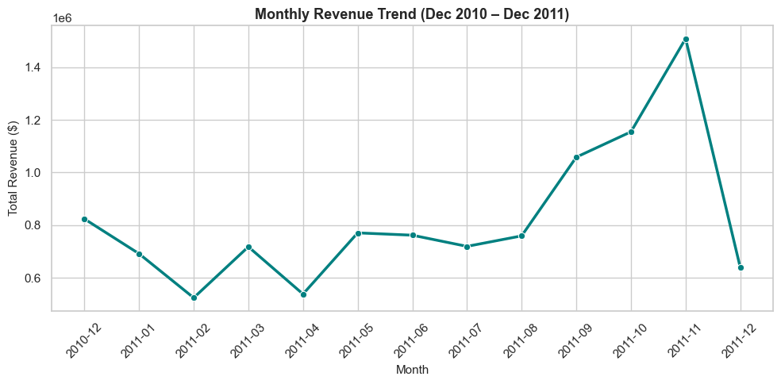
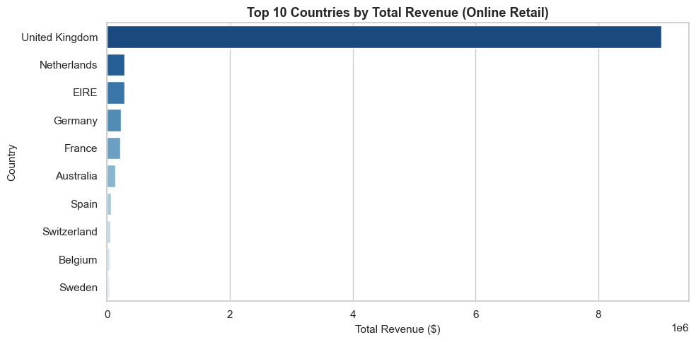
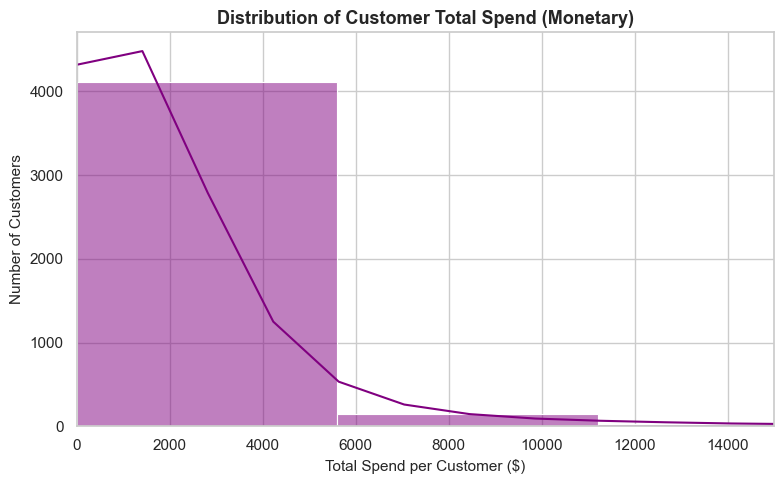
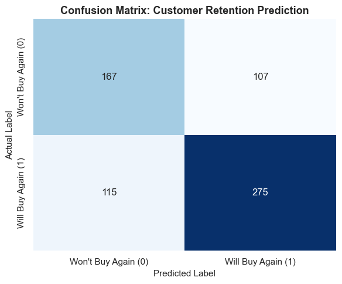
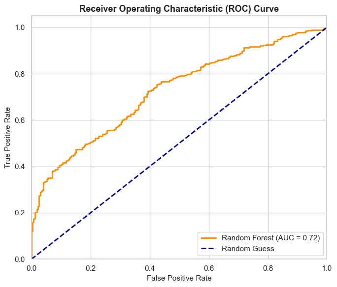
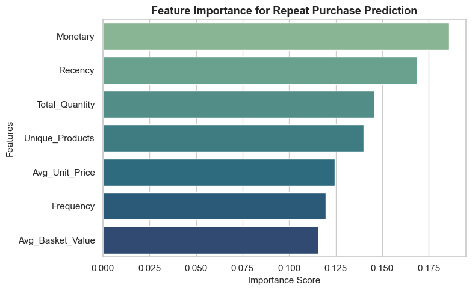

# Who Will Buy Again? Predicting Repeat Customers for an Online Retailer

**A classification model that predicts which customers will purchase again in the next three months, using only their past transaction behaviour. Marketing can then spend its retention budget on the customers most likely to slip away.**

`Python` · `pandas` · `scikit-learn` · `Random Forest` · `RFM feature engineering` · `ROC-AUC`

---

## TL;DR

- Starting from **541,909 raw transactions**, I built a customer-level dataset of **3,317 customers** with seven behavioural features, and a target labelling who returned in the following three months.
- A Random Forest reaches **ROC-AUC 0.72** and **67% accuracy** on held-out customers, against a 59% "everyone returns" baseline. It correctly flags **71% of returning customers** and **61% of those who won't return**.
- **Total spend (Monetary)** and **recency of last purchase** are the strongest signals. Customers who spend more and bought recently are far more likely to come back.

---

## The business problem

Retention campaigns (discount codes, win-back emails, loyalty perks) cost money. Sending them to everyone wastes budget on customers who would have returned anyway, and sending them to no one lets at-risk customers drift away.

**The question:** *Can we predict which customers will make another purchase in the next 3 months, so the business can target the at-risk ones with retention campaigns?*

**Who this is for:** marketing and CRM teams, customer-success teams, and finance (campaign ROI).

## The data

**[UCI Online Retail](https://archive.ics.uci.edu/dataset/352/online+retail):** every transaction from a UK-based online gift retailer between **1 Dec 2010 and 9 Dec 2011**, with 541,909 rows × 8 columns (invoice, product, quantity, date, unit price, customer ID, country). Many customers are wholesalers. Prices are in **pounds sterling (£)**.

### Data quality issues found
| Issue | Scale | How I handled it |
|---|---|---|
| Missing `CustomerID` | 135,080 rows (**24.9%**) | Dropped. A purchase that can't be tied to a person can't inform a customer-level prediction. |
| Cancelled invoices (`InvoiceNo` starting with `C`) | ~9,300 rows | Removed, so returns don't count as purchases. |
| Zero or negative unit prices | small | Removed (adjustments and data errors). |
| Non-UTF-8 characters | whole file | Read with `latin-1` encoding. |

## Exploratory findings

<p float="left">
  
  
</p>

- **Strong Q4 seasonality.** Monthly revenue climbs from September and peaks in **November 2011 at about £1.5M**, nearly 3× the February low. (December 2011 looks like a drop only because the data stops on 9 December.)
- **The UK dominates revenue.** International markets are a long tail, so country-level patterns are driven almost entirely by UK customers.
- **Customer value is extremely skewed.** Most customers spend modest amounts while a small group of high-value (often wholesale) buyers drive bulk revenue.



## Modelling approach

### 1. Framing the target without leaking the future
This is the most important design decision. I split time at a **cutoff date of 1 September 2011**:

```
 ┌──────────── feature window ────────────┐┌──── target window ────┐
 Dec 2010                          31 Aug 2011  1 Sep 2011     9 Dec 2011
 (features built only from here)              (did the customer buy again?)
```

- **Features** use only transactions *before* the cutoff.
- **Target** `Will_Buy_Again = 1` if the customer made any purchase between 1 Sep and 9 Dec 2011.

This mirrors real deployment: score customers today using what you know today, and find out later whether they came back. Computing features over the full year would let the model "see" the very purchases it is meant to predict.

### 2. Feature engineering: RFM and beyond
I aggregated transactions into seven customer-level features:

| Feature | Definition | Intuition |
|---|---|---|
| **Recency** | Days from last purchase to the cutoff | Recent buyers are still engaged |
| **Frequency** | Number of unique invoices | Habitual buyers return |
| **Monetary** | Total spend | High-value customers are invested |
| Unique_Products | Distinct products bought | Breadth of relationship |
| Avg_Unit_Price | Mean price per item | Premium vs budget shopper |
| Total_Quantity | Units bought | Volume / wholesale signal |
| Avg_Basket_Value | Mean spend **per invoice** | Order size. Computed at invoice level so big orders aren't counted once per line item. |

### 3. Training choices
| Decision | Why |
|---|---|
| **Stratified 80/20 split** | The classes are 59% returning / 41% not. Stratifying keeps that ratio identical in train and test, so scores aren't distorted by an unlucky split. |
| **Pipeline: median imputation → scaling → Random Forest** | Keeps preprocessing reproducible and fitted on training data only. |
| **Random Forest (100 trees, max depth 10)** | Captures non-linear effects and interactions between features (e.g. recency × frequency) without manual feature engineering. Depth 10 limits overfitting to individual customers. |
| **Evaluate with ROC-AUC, not just accuracy** | A marketing team will pick its own probability cutoff depending on campaign budget. AUC measures how well the model *ranks* customers across every possible cutoff. |

## Results

On **664 held-out customers**:

| Metric | Score |
|---|---|
| **ROC-AUC** | **0.72** |
| Accuracy | 0.67 (baseline "predict everyone returns": 0.59) |
| Returning customers: precision / recall | 0.72 / 0.71 |
| Non-returning customers: precision / recall | 0.59 / 0.61 |

<p float="left">
  
  
</p>

- Of 274 customers who **didn't** return, the model flagged **167** as at-risk (61%).
- Of 390 who **did** return, it correctly identified **275** (71%).
- **107 false alarms** are customers who would have returned anyway; a retention offer sent to them is the cost of reaching the real at-risk group.

### What drives repeat purchases



**Monetary** and **Recency** lead, followed by quantity and product breadth. Importance is spread fairly evenly across all seven features, which suggests return behaviour depends on the overall shape of the customer relationship rather than any one number.

## Conclusions for stakeholders

| Stakeholder | What this means | Recommended action |
|---|---|---|
| **Marketing / CRM** | The model ranks customers by return likelihood far better than chance (AUC 0.72). | Score all customers monthly. **Target the lowest-probability segment** with win-back offers instead of blanket discounts. |
| **Customer success** | Long gaps since last purchase are an early warning sign. | Trigger a **"we miss you" touchpoint** once a customer passes a recency threshold, before they're lost. |
| **Account management** | High spenders and wide-basket buyers are the most loyal, and the most valuable to keep. | Give **VIP / wholesale customers** dedicated attention. Losing one costs far more than losing a small buyer. |
| **Finance** | Each false alarm is a discount given to a customer who would have returned anyway. | Pick the probability cutoff based on **campaign cost vs customer value** rather than the default 0.5. |
| **Planning** | Revenue surges September–November. | **Launch retention campaigns in late summer**, ahead of the Q4 peak, to bring lapsed customers back for peak season. |

**Bottom line:** Even a simple behavioural model lets the business replace blanket discounts with **targeted retention spend**, focusing effort on the customers most likely to leave.

## Limitations and next steps
- **Tune the decision threshold** with a cost-benefit curve (campaign cost vs customer lifetime value) instead of the default 0.5.
- **Compare against a logistic regression baseline**, which is easier to explain to non-technical stakeholders.
- **Add features**: tenure (days since first purchase), return/cancellation rate, purchase-interval regularity, and seasonality of each customer's buying.
- **Validate across time**: repeat the setup with several cutoff dates to confirm the model holds up across seasons, not just this autumn.

## Run it yourself

```bash
pip install -r requirements.txt
jupyter notebook repeat_purchase_prediction.ipynb
```
`retail_data.csv` is about 45 MB.

## Repository layout
```
repeat_purchase_prediction.ipynb   # cleaning, feature engineering, model, evaluation, EDA
retail_data.csv                    # UCI Online Retail transactions
images/                            # charts used in this README
requirements.txt
```

---
*Analysis by Patrick Jastia.*
